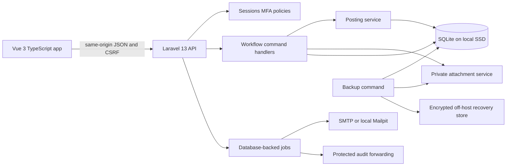

# Design: FirmLedger

## Overview

FirmLedger is a same-origin web application for one professional services firm. A Vue 3 and TypeScript single-page application presents role-specific finance work; a PHP 8.4 and Laravel 13 API owns authorisation, validation, calculations, posting and persistence; and a file-backed SQLite database stores the books on local SSD. All money is held as integer paise, business dates use Asia/Kolkata, and audit timestamps use UTC.

The application is organised around explicit commands and immutable financial evidence. Draft records may be revised, but submitted revisions are read-only. The last required independent approval calls the posting service, which performs policy checks, period checks, allocation checks, numbering, source update, balanced journal creation, audit append and idempotency recording in one short transaction. Posted records are corrected only by linked reversals in an open period.

Northline Advisory is an isolated, opt-in Demo company. Its stable seed identities make `php artisan firmledger:demo-seed` additive and repeatable: a second run leaves changed records and files untouched and inserts only missing fixtures. Production rejects that command.

## Architecture

### Repository and process layout

- Laravel is the root application and serves `/api/v1/**`, `/api/health`, private downloads and the built Vue assets.
- The Vue application lives under `resources/js/`, uses Vue Router, Pinia and Vite, and sends credentials only to the same origin.
- Domain code is split into Identity, Configuration, Documents, Approvals, Posting, Banking, Reporting, Close, Audit, Demo and Operations modules. Controllers translate HTTP only; command handlers own workflows; policies own role checks; the posting service is the sole general-ledger writer.
- Laravel database jobs deliver mandatory email, forward audit events and perform operational work. An outbox row is committed with the business transaction so delivery can retry without losing the event.
- Local development uses the selected SQLite file and private storage directory. Production uses Nginx, PHP-FPM, a service account, TLS, local SSD and network or VPN admission; only Laravel's `public/` directory is served.

### Concurrency and transaction contract

- Every SQLite connection enables foreign keys, WAL mode and `synchronous=FULL`. Transactions stay short and never scan files or send email.
- Posting, approval, import and reversal commands require `Idempotency-Key`. A unique request-key row stores the actor, route, canonical payload hash, status and response. An identical retry returns the stored response; a changed payload returns `409`.
- Laravel retries bounded `SQLITE_BUSY` failures with jitter. Exhaustion returns `503` with code `database_busy`, a `Retry-After` header and no partial effect.
- Optimistic edits send the current `revision`; stale revisions return `409 revision_conflict` with the current revision.
- Unique constraints protect fiscal-year invoice numbers, Supplier and normalised reference pairs, source-event journals, approvers per revision, statement content hashes, statement rows, matches and demo seed keys.

## Frontend components and navigation

### Shared application shell

`AppShell` contains the product and Demo company banner, role-aware navigation, work-queue count, current company and period, account menu and connectivity status. `MoneyText`, `BusinessDate`, `StatusBadge`, `DataTable`, `FilterBar`, `FormField`, `ErrorSummary`, `ApprovalTimeline`, `JournalLink`, `AttachmentViewer`, `ConfirmDialog` and `ToastRegion` provide consistent behaviour. Desktop uses a persistent left navigation; phone uses a top bar and labelled navigation drawer. Route guards improve navigation but Laravel policies remain authoritative.

### Screens

1. **Sign in** — email and password lead to a time-based one-time-code step; recovery codes are a separate one-use path. Demo mode identifies the selected demo account and provides MFA enrolment instructions.
2. **Work queue** — role-specific cards and a filterable list show Submitted, Returned and operational items. Finance preparers see drafts and returned work; Finance managers and Finance directors see only decisions within their authority.
3. **Finance configuration and master data** — legal entity, departments, fiscal periods, bank accounts, tax codes, numbering, accounts, Clients and Suppliers use searchable lists, archive actions and revision-aware editors.
4. **Client invoices and receipts** — a document workspace combines header, editable line table, live totals, validation, revisions, approval history, journal and settlement status. Posted invoices have a print layout. Receipt allocation shows outstanding invoices for the selected Client and remaining-to-allocate totals.
5. **Supplier bills and payments** — the bill workspace adds private attachment upload, scan status, inline evidence preview and duplicate-reference feedback. Payment allocation shows approved unpaid bills and the manager and Finance director approval stages when applicable.
6. **Journals and budgets** — balanced debit and credit entry provides running totals and difference; reversals show the original journal and mandatory reason; budgets use department, expense account, month and amount.
7. **Bank reconciliation** — a guided statement import previews row-numbered errors, followed by a two-sided reconciliation workspace. Suggested and confirmed matches sit between statement and book columns; unmatched items, explanations, adjusted balance and difference remain visible. Finalization is enabled only at zero difference with all prerequisites met.
8. **Financial reports** — report tabs cover trial balance, profit and loss, balance sheet, receivables ageing, payables ageing and budget variance. Filters and date basis precede a drill-down table; summary figures open source journals; export applies the active filters across all pages.
9. **Month-end close** — a checklist dashboard groups controls, pending work, reconciliations, exceptions, reports and approvals. Close and reopen timelines identify both independent actors and every close version.
10. **Audit search** — filters by event, actor, date, target and invoice number; results reveal redacted changes and links among documents, decisions, journals, reversals and report evidence without edit controls.
11. **User and service administration** — System administrators manage individual accounts, one role per user, deactivation and MFA recovery, and see release, health, errors, lock waits, backup, disk and audit-delivery status without business figures.
12. **Release acceptance** — A01–A08 runs are listed by release with Passed, Failed or Blocked status, timestamp and evidence. The release decision is Blocked whenever a mandatory condition remains.

## API conventions

All business endpoints are under `/api/v1`. JSON uses camelCase. Dates are `YYYY-MM-DD`, timestamps are UTC ISO 8601 strings, and money fields end in `Paise` and contain integers. Lists accept `page`, `pageSize`, `sort` and documented filters and return `{data, meta:{page,pageSize,total}}`. Commands return the resulting resource and audit/request identifiers.

Errors use `{error:{code,message,fields?,retryable?,requestId}}`: `401` for no active session, `403` for a forbidden role or self-approval, `409` for revision, idempotency or uniqueness conflicts, `422` for field or business validation, and `503` for exhausted database locks. Error messages contain no protected record content.

### Identity and administration endpoints

- `GET /api/health` returns `200 {status,releaseId}` and performs a read-only database check.
- `GET /api/v1/csrf` returns `204` and establishes the CSRF cookie.
- `POST /api/v1/auth/login` accepts `{email,password}` and returns `{mfaRequired,challengeId}`; `POST /api/v1/auth/mfa` accepts `{challengeId,code}` and returns `{user,expiresAt}`.
- `POST /api/v1/auth/recovery` accepts `{challengeId,recoveryCode}`; `POST /api/v1/auth/logout` accepts `{}` and returns `204`; `GET /api/v1/me` returns the current user, role and permissions.
- `GET /api/v1/work-queue` accepts role-appropriate status and type filters and returns queue items.
- `GET|POST /api/v1/users`, `GET|PATCH /api/v1/users/{id}` manage `{name,email,role,status,revision}`. `POST /api/v1/users/{id}/deactivate` accepts `{revision}`; `POST /api/v1/users/{id}/mfa-recovery` accepts `{identityCheckReference}` and returns one-use recovery codes once.
- `GET /api/v1/service-status` returns operational status without business figures. `GET|POST /api/v1/acceptance-runs` and `GET|PATCH /api/v1/acceptance-runs/{id}` manage `{releaseVersion,tests:[{testId,result,evidence}],releaseDecision}` for A01–A08.

### Configuration endpoints

- `GET|PATCH /api/v1/company` reads or updates `{legalName,registeredAddress,timeZone,fiscalYearStartMonth,retentionYears,revision}`.
- `GET|POST /api/v1/departments`, `/api/v1/chart-accounts`, `/api/v1/bank-accounts`, `/api/v1/tax-codes`, `/api/v1/clients` and `/api/v1/suppliers`; item routes support `GET` and `PATCH`. Master items use `{code,legalName?,address?,referenceId?,paymentTermsDays?,taxId?,status,revision}` as applicable.
- `POST /api/v1/{masterArea}/{id}/archive` accepts `{revision}` and returns the archived resource while posted snapshots retain captured values.

### Document, approval and posting endpoints

- `GET|POST /api/v1/invoices` creates or lists invoices. Create accepts `{clientId,documentDate,dueDate,reference,lines:[{description,quantity,unitRatePaise,accountId,departmentId,taxCodeId}]}`. `GET|PATCH /api/v1/invoices/{id}` reads or edits a draft with `revision` on patch.
- `POST /api/v1/invoices/{id}/submit` accepts `{revision}` and returns the submitted revision. `GET /api/v1/invoices/{id}/print` returns print HTML. Invoice totals returned by the API replace Vue previews.
- `GET|POST /api/v1/receipts` uses `{clientId,bankAccountId,businessDate,reference,amountPaise,allocations:[{invoiceId,amountPaise}]}`; `POST /api/v1/receipts/{id}/submit` accepts `{revision}`.
- `GET|POST /api/v1/bills` uses `{supplierId,supplierDocumentReference,documentDate,dueDate,lines:[{description,quantity,unitRatePaise,accountId,departmentId,taxCodeId}]}`. Item and submit routes mirror invoices.
- `POST /api/v1/bills/{id}/attachments` is multipart with field `file`; it returns `{attachmentId,fileName,size,mimeType,scanStatus}`. `GET /api/v1/attachments/{id}` authorises and streams a clean private file.
- `GET|POST /api/v1/payments` uses `{supplierId,bankAccountId,paymentDate,bankReference,amountPaise,allocations:[{billId,amountPaise}]}`; `POST /api/v1/payments/{id}/submit` accepts `{revision}`.
- `GET|POST /api/v1/manual-journals` uses `{businessDate,reason,lines:[{accountId,departmentId,debitPaise,creditPaise}]}`; submit follows the common command.
- `GET|POST /api/v1/budgets` uses `{departmentId,expenseAccountId,month,amountPaise}`; submit follows the common command.
- `GET /api/v1/approvals/{id}` returns the revision, evidence and decisions. `POST /api/v1/approvals/{id}/approve` and `/return` accept `{revision,reason?}`; return requires `reason`. The server determines whether this is the last required approval.
- `POST /api/v1/reversals` accepts `{sourceType,sourceId,businessDate,reason}`; `POST /api/v1/reversals/{id}/submit` accepts `{revision}`. Settlement reversal restores allocations exactly once.
- Successful modifying commands above require `Idempotency-Key`; approval responses include `{status,postingStatus,journalId?,approvalSteps}`.

### Banking and close endpoints

- `POST /api/v1/statement-imports/preview` is multipart with `bankAccountId` and `file`; it returns `{previewToken,statementPeriod,openingBalancePaise,closingBalancePaise,rows,errors:[{row,field,message}]}` without persistence.
- `POST /api/v1/statement-imports` accepts `{previewToken}` and returns the imported statement or the existing statement for the same content identity.
- `GET /api/v1/reconciliations/{id}` returns statement rows, book movements, suggestions, confirmed matches, outstanding explanations and balances.
- `POST /api/v1/reconciliations/{id}/matches` accepts `{statementLineId,bookMovementId}`; `DELETE /api/v1/reconciliations/{id}/matches/{matchId}` removes a draft match; duplicate use returns `409 match_conflict`.
- `PATCH /api/v1/reconciliations/{id}/outstanding/{bookMovementId}` accepts `{explanation,revision}`. `POST /api/v1/reconciliations/{id}/submit` accepts `{revision}`; `POST /api/v1/reconciliations/{id}/finalize` accepts `{revision}` and requires a Finance manager.
- `GET /api/v1/periods/{id}/close-readiness` returns `{checks,blockingItems,reconciliations,reports,currentVersion}`.
- `POST /api/v1/periods/{id}/close-requests` accepts `{revision}`; `POST /api/v1/periods/{id}/close-approve` accepts `{requestId,revision}`.
- `POST /api/v1/periods/{id}/reopen-requests` accepts `{reason,revision}`; `POST /api/v1/periods/{id}/reopen-approve` accepts `{requestId,revision}`. Approvals atomically preserve snapshots and history and return the new period state and version.

### Reporting and evidence endpoints

- `GET /api/v1/reports/trial-balance`, `/profit-and-loss`, `/balance-sheet`, `/receivables-ageing`, `/payables-ageing` and `/budget-variance` accept their required `from`, `to`, `asOf`, `month`, `departmentId` and account filters. They return `{dateBasis,closeVersion?,summary,rows,meta}`.
- Appending `/export` to a report endpoint returns UTF-8 CSV for every filtered row, with quoted fields and formula-leading text prefixed safely.
- `GET /api/v1/journals/{id}` returns immutable source, period, approvers and exactly balanced lines.
- `GET /api/v1/audit-events` accepts actor, event, target, invoice number and UTC range filters and returns redacted append-only evidence.

## Data model

Every table has a stable UUID primary key unless a sequential identifier is itself business evidence. Money columns are signed 64-bit integer paise. Business dates are date values; audit and system times are UTC timestamps.

### Identity and configuration

- `users`, `roles`, `sessions`, `mfa_enrolments`, `recovery_codes` and `login_attempts` implement individual accounts, one role per user, session revocation, TOTP and hashed one-use recovery.
- `companies`, `departments`, `chart_accounts`, `bank_accounts`, `fiscal_periods`, `tax_codes`, `tax_rate_versions` and `invoice_sequences` hold one-firm configuration. Normalised codes are unique; tax rates are dated and immutable once used.
- `parties` holds Clients and Suppliers with legal name, address, reference, terms, tax ID and archive state. Posted documents copy the applicable party and configuration snapshot.

### Documents and ledger

- `documents` is the shared invoice, bill, receipt, payment, manual journal, reversal and budget header, with type, party, dates, status, settlement status, total paise, revision and source reference.
- `document_lines`, `document_tax_lines`, `document_snapshots`, `attachments`, `settlements` and `allocations` hold coded lines, rounded tax, immutable posted values, content-hashed private files and dated allocations.
- `approval_steps` records actor, role, revision, decision, reason and UTC time. Database uniqueness prevents one actor taking the same step twice.
- `journals` has permanent journal ID, source event, business date, period, request key and reversal state. `journal_lines` contains account, department and exactly one positive debit or credit. Only the posting service inserts these rows after checking exact equality.
- `reversal_links` links each correction to its original and prevents a settlement allocation being restored more than once.
- `budgets` identifies department, expense account and calendar month; only the approved current revision is active.

### Banking, close and evidence

- `statement_imports` stores bank account, period, opening and closing paise, content identity and status. `statement_lines` stores row identity, date, signed amount, reference and description.
- `bank_matches` uniquely relates one statement line to one book movement. `reconciliations`, `reconciliation_explanations` and `reconciliation_signatures` preserve calculations, outstanding items and both identities by version.
- `close_requests`, `close_versions` and `close_snapshots` preserve checks, report payload hashes, report data, close and reopen history. A period state guard rejects every dated write into a closed period.
- `request_keys` guarantees command idempotency. `audit_events` is append-only through application permissions. `outbox_messages` provides retryable mandatory notification and audit-forwarding delivery.
- `acceptance_runs` and `acceptance_results` retain A01–A08 release evidence and the resulting release decision.
- `demo_seed_registry` records stable fixture key, entity type, entity ID and original content hash. The loader inserts an absent fixture, recognises an unchanged fixture, and never overwrites a fixture whose current hash differs.

### Important indexes and integrity checks

- Index document status, type, party and dates; journal business date, period, account, department and source; allocations by document; statements by bank account and period; queue items by role and status; and audit events by timestamp, actor, target and event.
- Enforce unique normalised master codes, fiscal-year invoice number, Supplier plus normalised document reference, source event per journal, statement content identity, statement row identity, each side of a bank match and request idempotency key.
- Check nonzero positive document totals, one-sided positive journal lines and valid state values in the database; enforce cross-row journal balance, independent approval, open period and available allocation in the posting transaction.

## Northline Advisory demo

The opt-in demo uses a dedicated SQLite file and private attachment directory. It creates Consulting and Operations; Cedar Analytics, Elm Studio and Harbor Research as Clients; Meridian Systems, Finch Office Supply and Juniper Hosting as Suppliers; one operating bank; and fictional `.example` contacts.

The exact posted April fixtures are: ₹5,00,000.00 opening Bank against Capital; Cedar Analytics invoice ₹1,00,000.00 net and ₹10,000.00 tax; Meridian Systems bill ₹40,000.00 net and ₹4,000.00 tax; Cedar Analytics receipt ₹60,000.00; and Meridian Systems payment ₹22,000.00. It also creates the approved ₹50,000.00 Consulting expense budget, statement movements +₹60,000.00 and −₹22,000.00 ready to match, the unposted Elm Studio May draft invoice of ₹12,000.00 net and the unposted Finch Office Supply submitted May bill of ₹8,000.00 net with a harmless PDF.

The 30 April 2026 reconciliation must resolve from ₹5,00,000.00 through those two movements to ₹5,38,000.00 with two matches and zero difference. Reports must derive ₹50,000.00 receivable, ₹22,000.00 payable, ₹60,000.00 net profit, ₹10,000.00 favourable budget variance, trial-balance debits and credits of ₹6,32,000.00, and assets ₹5,92,000.00 equal to liabilities ₹32,000.00 plus equity including profit ₹5,60,000.00.

`php artisan firmledger:demo-seed` checks the environment, starts one transaction, and uses stable fixture keys and content hashes. It does not update or delete existing rows, changed user work or existing files. `php artisan firmledger:demo-reset` names the selected demo database, displays its path, requires explicit confirmation and cannot target production.

## Security, privacy and audit

- Production uses HTTPS; Secure, HttpOnly and SameSite session cookies; session-ID rotation; CSRF on modifications; framework password hashing; TOTP MFA; hashed one-use recovery codes; generic sign-in errors; account and source rate limits; 30-minute idle and eight-hour absolute expiry.
- Five failed attempts for an account in 15 minutes throttle it for 15 minutes. Deactivation revokes active sessions. Production bootstrap creates the first System administrator from protected deployment values and has no shared or default credential.
- Laravel policies enforce every API action, export and file download. The System administrator has no business report or approval permission. Support never impersonates a user.
- Attachments use server-generated private names outside the web root, verified MIME signatures, a 10 MB limit and scanning. Pending or failed files are quarantined; only clean files can support submission or download.
- Logs and audit changes redact passwords, MFA secrets, full bank details and file contents. Audit rows cannot be updated or deleted through the application and are forwarded to separately protected storage.
- Financial records, approvals, evidence and audit history remain for eight financial years or the longer approved period. Expired personal data is deleted only after an administrator decision while required evidence remains access-restricted.

## Notifications and background work

Submitting an invoice, bill, payment, journal, budget or close request writes one in-app queue item and one mandatory email outbox message for each required reviewer. Mandatory approval email has no preference switch. Backup failure, posting failure, lock exhaustion and audit-delivery gaps similarly notify System administrators and the release owner. Delivery retries are idempotent and visible in service status.

Local development starts Mailpit and points `.env.example` SMTP values to it so every workflow can be exercised. The queue worker and scheduler run under the local launcher and production service definitions.

## Error handling

- Forms retain entered values and place field errors beside controls plus links in an error summary. Business conflicts show the current state and safe next action without silently retrying a financial command under a new key.
- Loss of connectivity shows a persistent offline banner and blocks mutation controls; no local finance record is queued for later submission.
- A posting transaction returns a stable request ID. Failures are audited where safe, alert on posting failure, consume no invoice number and leave no source, journal, allocation or approval partial state.
- Upload scan failures explain that submission is blocked without exposing scanner internals. Report/export failures retain filters. Accessibility announcements use a polite status region for success and an assertive alert for blocking errors.

## Operations and recovery

Windows setup is documented in PowerShell. A doctor command resolves Node, PHP and Composer, honours `PHP_BIN`, verifies required PHP extensions including `pdo_sqlite`, and checks writable data and attachment directories while reporting each missing prerequisite once. The launcher installs pinned dependencies, selects only the demo database, migrates, safely seeds, starts Mailpit, queue, Laravel and Vite, probes the launcher instance, and prints its actual URL. It first tries the preferred port, then chooses an available port without stopping the process already using it.

Production deploys built Vue assets and Laravel to a dedicated Linux host behind Nginx and PHP-FPM. SQLite, uploads, secrets and runtime data are outside the public directory on local SSD. Services run as a restricted account; debug and demo loading are disabled; admission is limited to the firm's network or VPN.

The backup command uses SQLite's online backup mechanism, captures referenced immutable attachments, encrypts the recovery point and transfers it off host at least every 10 minutes. Daily copies remain for 35 days. Restore drills use an isolated host and verify database integrity, file hashes, latest audit sequence, trial balance and receivables and payables control totals, recording last recoverable write and elapsed recovery time. Monitoring exposes release ID, health, HTTP and application errors, posting failures, lock waits, backup age, disk and audit delivery without business reports.

## Testing strategy

- **PHP unit and feature tests:** Pest tests policies, half-up paise arithmetic, state transitions, independent approval, threshold rules, posting balance, reversal restoration, report calculations, CSV hardening and API error contracts. Feature tests create a temporary SQLite file, run migrations, call the API and remove the file.
- **Vue tests:** Vitest and Vue Test Utils cover route guards, financial previews, allocation interaction, reconciliation calculations, validation summaries, keyboard operation and responsive components. The Laravel response remains authoritative.
- **Integration and concurrency tests:** separate database connections test competing payments, stale revisions, duplicate references, idempotent retries, forced mid-transaction failures, busy exhaustion and the single-journal invariant.
- **End-to-end journeys:** Playwright tests under `e2e/` use the running application for each role on desktop and phone viewports. They cover sign-in, pending bill review, statement matching, April close evidence and service restart persistence. Axe checks report serious and critical findings.
- **Demo verification:** an isolated demo database is seeded twice, with user changes inserted between runs, and compared for fixture counts, hashes, files, April balances and the five-role journeys.
- **Capacity and recovery:** the dedicated-host suite loads 25 named staff, 10 active users and 100,000 journal lines, runs readers and writers for 30 minutes and records p95, errors and lock waits. The recovery suite restores an encrypted off-host point and measures data loss and elapsed restoration.
- **Acceptance A01–A08:** a release runner records actual Passed, Failed or Blocked results and evidence against the real Vue frontend, Laravel API and file-backed SQLite. A01 covers access and session; A02 invoice to cash; A03 bill to payment; A04 race and reversal; A05 bank and close; A06 reports, CSV, terminology, INR/date formatting, desktop/mobile feedback, keyboard approval and accessibility; A07 capacity, rollback, backup and recovery; A08 repeatable demo data and production refusal. Financial mismatch, failed recovery, failed mandatory test, or unresolved critical or high security defect blocks release.

## Look and feel

FirmLedger uses a calm, high-contrast financial-control style. The page background is `#F4F7F9`, surfaces are `#FFFFFF`, primary text is `#17212B`, the main action colour is `#0B6B5B`, success is `#16794A`, and error is `#B42318`. Secondary text uses `#52606D`, borders use `#CBD5E1`, warning uses `#9A6700`, and focus uses `#2563EB`. The font is Inter with system sans-serif fallback. The spacing scale is 4, 8, 12, 16, 24 and 32 px; controls and cards use an 8 px corner radius.

Buttons have a 44 px minimum touch height, visible label, icon only when supplementary, and distinct hover, focus-visible, pressed and disabled states. Primary buttons darken on hover and pressed state; disabled controls retain readable text and explain unavailable workflow actions. Fields keep labels above values, use persistent help and error space, and show a 3 px focus ring. Lists use sticky labelled headers on desktop and labelled cards on phone; status never relies on colour alone. Financial figures use tabular numerals and align by decimal meaning. Empty, loading, success, warning and failure states are designed components rather than bare text.

The sign-in card is centred at a readable width on desktop and fills the phone width with safe margins. Work queues use summary cards above a dense sortable table on desktop and filters above stacked task cards on phone. Document screens use a main editor with a right totals and approval rail on desktop; phone order is header, lines, totals, evidence, actions and timeline. Line tables become labelled cards with add/edit sheets on phone.

Bank reconciliation uses side-by-side statement and book panes with a central match action and sticky balance summary on desktop. On phone it uses tabs for Statement, Book and Matches, while the difference and finalize state remain sticky. Reports use a horizontal filter bar and table on desktop; on phone filters open in a sheet, summaries precede horizontally scrollable detail, and drill-down opens a full-width panel. Month-end close uses a two-column checklist and evidence panel on desktop and a single ordered checklist on phone. Administration and audit screens follow the same responsive list-detail pattern.

Every screen supports keyboard operation, logical focus order, skip links, semantic headings, labelled regions, programmatic status, error summaries, 200% zoom and reflow without losing actions. Motion is brief and respects reduced-motion preferences.

## Build and run

Install: composer install && npm install
Test: composer test && npm test
Run locally: yes
Dev: npm run dev
Port variable: PORT
Health path: /api/health
Devices: both
Deploy: dedicated-linux

## Test logins

- Finance preparer — user name `preparer@northline.example`; password and MFA enrolment are generated during local setup and written to the ignored demo credentials file.
- Finance manager — user name `manager@northline.example`; password and MFA enrolment are generated during local setup and written to the ignored demo credentials file.
- Finance director — user name `director@northline.example`; password and MFA enrolment are generated during local setup and written to the ignored demo credentials file.
- Auditor — user name `auditor@northline.example`; password and MFA enrolment are generated during local setup and written to the ignored demo credentials file.
- System administrator — user name `admin@northline.example`; password and MFA enrolment are generated during local setup and written to the ignored demo credentials file.

## Assumptions

- Laravel and the Vue application share one repository and one origin, with Laravel serving the production assets and Vite proxying `/api` during development.
- Local mandatory email is captured by Mailpit; production SMTP and separately protected audit and backup destinations are supplied as deployment configuration.
- The root `npm run dev` script is the Windows-aware launcher that selects a free page port, starts all local processes and prints the verified URL.
- Demo credentials are generated per setup rather than stored in the repository, and their ignored local credentials file is the source shown to testers.
- The acceptance-result screen records evidence produced by test commands and authorised testers; it does not infer Passed status from an unchecked checklist.
